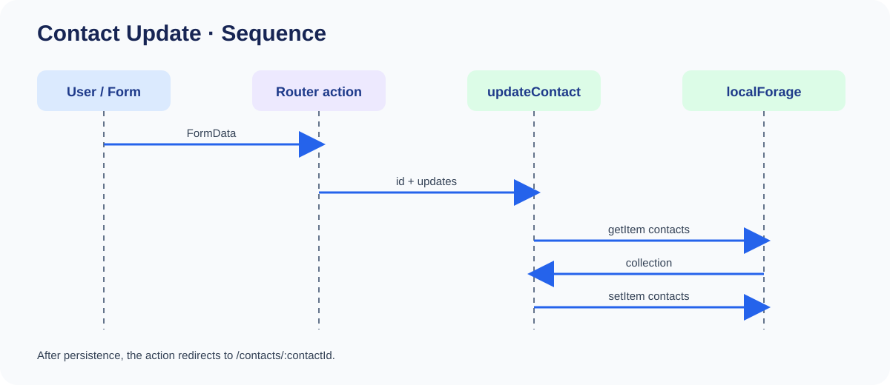
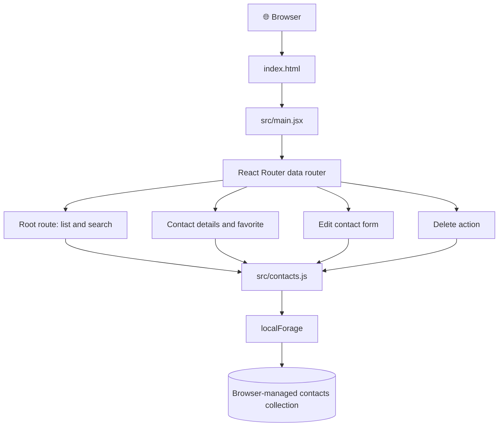

<p align="center">
  
</p>

<div align="center">

# 👤 Contact Display

**A client-side contact manager built with React 18, React Router, Vite, and localForage.**

[](https://react.dev/)
[](https://vitejs.dev/)
[](https://reactrouter.com/)
[](LICENSE)
[](https://github.com/Brajesh31/Contact-Display/commits/main)
[](docs/README.md)

</div>

---

## 📌 Project at a glance

| Property | Current repository evidence |
|---|---|
| Product | Browser-based contact organizer and React Router data-router learning project |
| Frontend | React 18 |
| Routing | React Router DOM 6 data APIs |
| Build tool | Vite 5 |
| Persistence | localForage, using browser-managed storage |
| Search | match-sorter |
| Sorting | sort-by |
| Styling | Application CSS and vendored Bootstrap 5.2.3 assets |
| Runtime model | Client-side application |
| Backend | No application server found in the inspected root project |
| Database server | No remote SQL/NoSQL database found |
| Public HTTP API | No server API contract found |
| Package manager | npm, with committed package-lock.json |
| Maintainer | Brajesh Kumar |

> [!IMPORTANT]
> **Architecture boundary:** this project is not documented as a MERN stack application. The inspected implementation uses localForage for browser-side persistence. It does not establish an Express server, MongoDB deployment, REST API, login system, multi-device synchronization, or server-side authorization.

## ✨ What the application does

| Feature | Current behavior | Main implementation |
|---|---|---|
| 📇 Contact list | Loads and displays saved contact records in the root sidebar. | `src/routes/root.jsx` |
| 🔎 Search | Submits a query and matches first/last names. | `root.jsx`, `src/contacts.js` |
| ➕ Create | Creates an empty contact record and redirects to its edit screen. | Root route action |
| 👁️ View | Loads one record and displays available contact fields. | `src/routes/contact.jsx` |
| ⭐ Favorite | Submits a favorite toggle using a React Router fetcher form. | `contact.jsx` |
| ✏️ Edit | Updates fields from a submitted form and redirects to details. | `src/routes/edit.jsx` |
| 🗑️ Delete | Requests browser confirmation, deletes the record, then redirects to root. | `src/routes/destroy.jsx` |
| 💾 Persistence | Stores the contact collection under localForage key `contacts`. | `src/contacts.js` |
| ⚠️ Route errors | Uses a router error element and a 404 response for unknown contact IDs. | `src/main.jsx`, route modules |

Feature descriptions reflect static inspection of source. They are not a claim that every route currently passes a runtime test. Known source-level concerns are listed in [Known issues](docs/known-issues.md).

## 🖼️ Visual identity and architecture

<p align="center">
  
</p>

<p align="center">
  
</p>

<p align="center">
  
</p>

The diagrams are documentation assets, not application runtime dependencies. Editable Mermaid sources and design notes are in [the architecture catalog](docs/architecture/README.md).

**Application screenshots:** genuine page screenshots have not yet been captured and verified in this repository. The architecture illustrations above are not presented as UI screenshots or product demo images.

## 🏛️ System architecture



### 🔀 Route inventory

| URL | Screen/action | Loader | Action | Result |
|---|---|---|---|---|
| `/` | Contact list and index | `rootLoader` | `rootAction` | Loads list/search; create action redirects to edit. |
| `/contacts/:contactId` | Contact details | `contactLoader` | `contactAction` | Displays a record; action toggles favorite. |
| `/contacts/:contactId/edit` | Edit form | `editLoader` | `editAction` | Loads form data, updates record, redirects to detail. |
| `/contacts/:contactId/destroy` | Destructive action route | None | `destroyAction` | Deletes record and redirects to root. |

Routes are registered in `src/main.jsx`. The destroy URL is an action endpoint inside the client router, not a remote HTTP DELETE API.

## 🧰 Technology stack

| Layer | Technology | Role |
|---|---|---|
| UI | React 18 | Component rendering and stateful interaction. |
| Routing | React Router DOM 6 | Browser route matching, loaders, actions, forms, and navigation. |
| Build | Vite 5 | Development server and production bundling. |
| Storage | localForage 1.10 | Browser-managed asynchronous storage abstraction. |
| Search | match-sorter 6 | Match contacts by first and last name. |
| Sorting | sort-by 1 | Order records by last name and creation time. |
| Styles | CSS and vendored Bootstrap 5.2.3 assets | Styling resources. |
| Static analysis | ESLint 8 | Configured lint command. |

Exact dependency ranges and scripts are defined in the existing `package.json` and `package-lock.json`. They are intentionally not changed by this repository documentation work.

## 🚀 Run locally

### Prerequisites
- Git
- Node.js compatible with the existing Vite 5 toolchain
- npm

No backend, database server, API secret, or project-specific environment variable is required by the inspected root manifest.

### Installation

```bash
git clone https://github.com/Brajesh31/Contact-Display.git
cd Contact-Display
npm ci
npm run dev
```

Vite prints the local address in the terminal.

### Available commands

| Command | Purpose |
|---|---|
| `npm ci` | Install exact dependencies from the npm lockfile. |
| `npm run dev` | Start the Vite development server. |
| `npm run build` | Create the production bundle in `dist/`. |
| `npm run preview` | Preview the generated production bundle locally. |
| `npm run lint` | Execute the configured ESLint command. |

The root manifest does not define `npm start`, a backend startup script, database migrations, or a test runner.

## 💾 Data model and privacy

The data helper uses localForage and a collection key named `contacts`. The observed object fields are:

| Field | Observed use | Notes |
|---|---|---|
| `id` | Record identity and route lookup | Generated by the current helper. |
| `createdAt` | Creation timestamp and sorting | Numeric timestamp. |
| `first`, `last` | Name display and search | Optional form values. |
| `avatar` | Avatar image URL | Can reference an external resource. |
| `website` | Website display/link | Current UI prefixes HTTPS. |
| `number` | Phone number display and edit | Form constrains a 3-3-4 digit pattern. |
| `notes` | Free-form contact notes | May contain personal information. |
| `favorite` | Star indicator and toggle | Form value is converted to a boolean. |

This is an observed JavaScript object shape, not a remote database schema. Data is scoped to browser storage for the current origin and browser profile. Clearing site data may remove it. No cloud backup or cross-device sync is shown.

**Privacy guidance:** avoid storing highly sensitive data. Protect shared browser profiles. Redact contact names, phone numbers, notes, and storage exports from issues, screenshots, and logs.

Read [Data architecture](docs/architecture/data-architecture.md) and [Privacy](docs/privacy.md).

## 🧪 Quality and verification

Application commands available from the existing package scripts:

```bash
npm run lint
npm run build
```

Documentation-only validation utilities:

```bash
python scripts/validate_docs.py
python scripts/validate_links.py
python scripts/validate_svg.py
```

A documented command is not evidence of a passing run. Check the associated GitHub Actions run or local exit code before claiming a check passed. There is no test runner declared in the inspected package manifest.

## 🔐 Security model

This is a client-side application. The browser profile and its storage are user-controlled. There is no verified server-side authentication or authorization layer. Contact fields and external URLs should be treated as untrusted input. The repository security policy is in [SECURITY.md](SECURITY.md), with technical details in [the security guide](docs/security.md) and [threat model](docs/threat-model.md).

## 📚 Documentation map

| Area | Documentation |
|---|---|
| 📌 Product | [Overview](docs/product-overview.md) · [Objectives](docs/product-objectives.md) · [Background](docs/project-background.md) · [Solution](docs/solution-overview.md) |
| ✨ Product behavior | [Features](docs/features.md) · [Functional requirements](docs/functional-requirements.md) · [Use cases](docs/use-cases.md) · [User journeys](docs/user-journeys.md) · [Scope and limitations](docs/scope-and-limitations.md) |
| 🏛️ Architecture | [Architecture](docs/architecture.md) · [System design](docs/system-design.md) · [Module dependencies](docs/architecture/module-dependency.md) · [Runtime sequence](docs/architecture/runtime-sequence.md) |
| 🗺️ Frontend | [Page documentation](docs/page-documentation.md) · [Navigation](docs/navigation-structure.md) · [Component inventory](docs/component-library.md) · [Design system](docs/design-system.md) · [Responsive review](docs/responsive-design.md) |
| 💾 Data | [Data flow](docs/data-flow.md) · [Data architecture](docs/architecture/data-architecture.md) · [Data dictionary](docs/architecture/data-dictionary.md) · [Persistence boundary](docs/database.md) |
| 🛠️ Development | [Installation](docs/installation.md) · [Getting started](docs/getting-started.md) · [Developer guide](docs/developer-guide.md) · [Commands](docs/commands-reference.md) · [Troubleshooting](docs/troubleshooting.md) |
| 🧪 Quality | [Testing](docs/testing.md) · [Test strategy](docs/test-strategy.md) · [Accessibility](docs/accessibility.md) · [Known issues](docs/known-issues.md) |
| 🚀 Operations | [Deployment](docs/deployment.md) · [CI/CD](docs/ci-cd.md) · [Monitoring](docs/monitoring.md) · [Maintenance](docs/maintenance.md) |
| 🔐 Security and privacy | [Security](docs/security.md) · [Threat model](docs/threat-model.md) · [Privacy](docs/privacy.md) · [Risk register](docs/risk-register.md) |
| 🧩 Reuse | [Templates](docs/templates/README.md) · [Visual assets](docs/assets/README.md) · [Architecture diagrams](docs/architecture/README.md) |

See the [complete documentation index](docs/README.md).

## 🛣️ Roadmap

Current source observations and proposals are separated in [ROADMAP.md](ROADMAP.md). Proposed fixes are not represented as implemented.

## 🤝 Contributing

Read [CONTRIBUTING.md](CONTRIBUTING.md). Repository documentation and maintenance changes should not rewrite application files without separate, explicit authorization.

## 📄 License

This repository includes an MIT license. See [LICENSE](LICENSE). Third-party and vendored components retain any applicable separate notices and license obligations.

## 👨‍💻 Maintainer

**Brajesh Kumar** · [GitHub](https://github.com/Brajesh31)

---

<sub>Documentation is based on static inspection of the repository's default branch. It does not certify runtime behavior, security, accessibility conformance, deployment status, or production readiness.</sub>

Last updated: 2026-11-18 02:36 UTC
