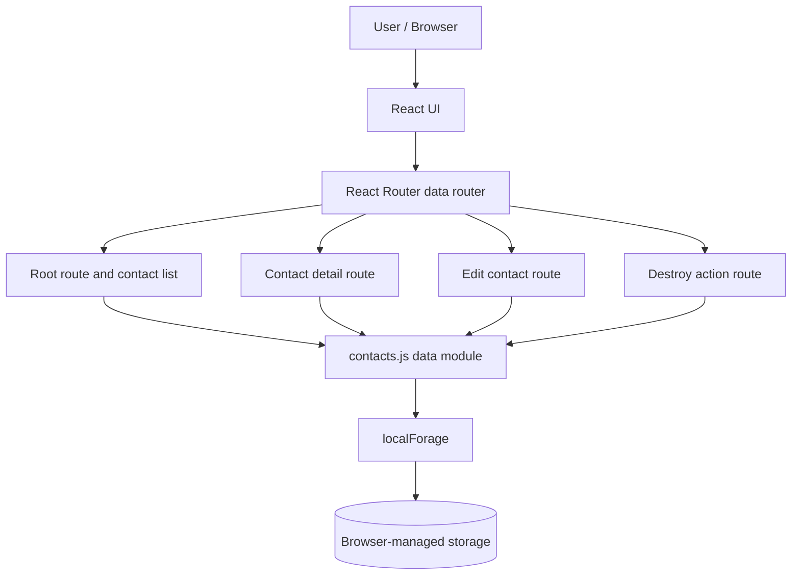

<p align="center">
  
</p>

<div align="center">

# 👤 Contact Display

**A browser-based contact manager built with React, React Router, Vite, and localForage.**

[](https://react.dev/)
[](https://vitejs.dev/)
[](https://reactrouter.com/)
[](LICENSE)
[](https://github.com/Brajesh31/Contact-Display/commits/main)

</div>

---

## ✨ Overview

Contact Display is a client-side contact-management application. It provides a contact list, search, contact detail view, create and edit forms, favorite toggling, and deletion. The inspected implementation uses React 18, React Router's data-router APIs, Vite, and localForage for browser-side persistence.

> [!IMPORTANT]
> This repository is not a MERN application. The inspected root project contains no Express server, MongoDB integration, REST API, or separate `server/` and `client/` directories. Contact records are stored in the browser through localForage. Documentation deliberately reflects this implementation.

## 🎯 Features

| Capability | Current implementation |
|---|---|
| 📇 Browse contacts | Root route loads and displays saved contacts. |
| 🔎 Search | Search query is submitted through React Router and matched against first/last names using `match-sorter`. |
| ➕ Create | The root route action creates a contact and redirects to its edit route. |
| 👁️ View details | Contact route loads a record by ID and displays available fields. |
| ⭐ Favorite | Contact action updates the `favorite` property. |
| ✏️ Edit | Edit route loads the record and persists submitted form values. |
| 🗑️ Delete | Delete route action removes a contact after browser confirmation. |
| 💾 Browser persistence | `localforage` stores the contacts collection in browser-managed storage. |
| 🧭 Client routing | `createBrowserRouter` defines the application routes. |

## 🧰 Technology stack

| Layer | Technology | Role |
|---|---|---|
| UI | React 18 | Component rendering and interactive interface. |
| Routing | React Router DOM 6 | Browser routes, loaders, actions, forms, navigation, and error boundaries. |
| Build tooling | Vite 5 | Development server and production bundling. |
| Persistence | localForage | Asynchronous browser-side storage abstraction. |
| Search | match-sorter | Matching contacts by first and last name. |
| Sorting | sort-by | Sorting contact records. |
| Styling | CSS and vendored Bootstrap 5.2.3 assets | Application styling and included framework assets. |
| Quality | ESLint | Static lint command defined in package scripts. |

## 🏛️ Architecture at a glance



See the [architecture guide](docs/architecture.md), [route inventory](docs/page-documentation.md), and [editable diagrams](docs/architecture/README.md).

## 🚀 Run locally

### Prerequisites

- Git
- Node.js compatible with the Vite 5 toolchain
- npm

No database server or backend service is configured in the inspected root project.

### Installation

```bash
git clone https://github.com/Brajesh31/Contact-Display.git
cd Contact-Display
npm ci
npm run dev
```

Vite prints the local development URL in the terminal.

### Available npm scripts

| Command | Purpose |
|---|---|
| `npm run dev` | Starts the Vite development server. |
| `npm run build` | Creates the production build using Vite. |
| `npm run preview` | Serves the generated build locally for preview. |
| `npm run lint` | Runs the configured ESLint command. |

`npm start`, a backend startup command, and database migration commands are not defined in the inspected `package.json`.

## 🗺️ Route inventory

| Route | Responsibility | Router behavior |
|---|---|---|
| `/` | Contact list and search | Root loader and create-contact action. |
| `/contacts/:contactId` | Contact details and favorite action | Contact loader and action. |
| `/contacts/:contactId/edit` | Edit a contact | Edit loader and update action. |
| `/contacts/:contactId/destroy` | Delete a contact | Destructive action followed by redirect. |

The route definitions are in `src/main.jsx`. Detailed route behavior and state transitions are documented in [page documentation](docs/page-documentation.md).

## 🗂️ Project structure

```text
Contact-Display/
├── .github/
│   └── workflows/
│       └── update-readme.yml       # Existing timestamp automation (preserved)
├── docs/                           # Product and engineering documentation
│   ├── architecture/               # Architecture views and diagrams
│   ├── assets/                     # Documentation-only visual assets
│   └── templates/                  # Reusable engineering templates
├── scripts/                        # Documentation validation utilities
├── public/                         # Existing public assets
├── src/
│   ├── routes/                     # Existing route modules
│   ├── css/bootstrap-5.2.3/         # Existing vendored framework tree
│   ├── contacts.js                 # Existing browser persistence/data operations
│   ├── contacts2.js                # Existing alternate data module
│   ├── main.jsx                    # Existing router and application entry point
│   └── index.css                   # Existing application styles
├── index.html                      # Existing Vite HTML entry
├── package.json                    # Existing package scripts and dependencies
├── package-lock.json               # Existing npm lockfile
├── vite.config.js                  # Existing Vite configuration
└── README.md
```

This is a high-level map. The exhaustive tracked-file inventory is maintained in [project structure](docs/project-structure.md).

## 💾 Data and privacy model

- Contact data is handled in the browser through localForage.
- The inspected data module uses a `contacts` collection and contact objects with fields such as `id`, `createdAt`, `first`, `last`, `avatar`, `website`, `number`, `notes`, and `favorite`.
- The repository does not show a remote database or backend synchronization service.
- Browser storage is scoped to the browser profile and origin. Clearing site data can remove locally stored records.
- Do not enter sensitive information unless you have assessed the security and privacy of the browser environment.

More detail: [data architecture](docs/architecture/data-architecture.md) and [privacy notes](docs/privacy.md).

## 🧪 Quality checks

Run the checks supported by the current package scripts:

```bash
npm run lint
npm run build
```

These commands have not been represented as passing merely because they are documented. CI and local execution results should be checked in the relevant run before a release.

## 🔐 Security

See [SECURITY.md](SECURITY.md) and the [security guide](docs/security.md). The current application is client-side and stores user-entered contact information in browser storage. There is no server-side authorization boundary in the inspected implementation.

## 📚 Documentation index

| Guide | Contents |
|---|---|
| [Product overview](docs/product-overview.md) | Purpose, audience, scope, and product behavior. |
| [Features and requirements](docs/features.md) | Feature inventory and requirements. |
| [Architecture](docs/architecture.md) | System structure and design. |
| [System design](docs/system-design.md) | Runtime, routing, and data design. |
| [Project structure](docs/project-structure.md) | Directory and file responsibilities. |
| [Page documentation](docs/page-documentation.md) | Routes, screens, actions, and interactions. |
| [Data flow](docs/data-flow.md) | Contact read/write lifecycle. |
| [Development guide](docs/developer-guide.md) | Setup, scripts, and workflow. |
| [Testing and quality](docs/testing.md) | Current checks and suggested verification. |
| [Deployment](docs/deployment.md) | Static build and hosting considerations. |
| [Security](docs/security.md) | Threats, controls, and limitations. |
| [Accessibility](docs/accessibility.md) | Accessibility review guidance. |
| [Known issues](docs/known-issues.md) | Source observations requiring follow-up. |
| [Architecture diagrams](docs/architecture/README.md) | Mermaid and SVG source assets. |
| [Templates](docs/templates/README.md) | Reusable project templates. |

## 🛣️ Roadmap

See [ROADMAP.md](ROADMAP.md). Planned improvements are clearly separated from existing features.

## 🤝 Contributing

Read [CONTRIBUTING.md](CONTRIBUTING.md) before proposing changes. This documentation-focused enhancement does not require changes to the completed application source.

## 📄 License

Distributed under the MIT License. See [LICENSE](LICENSE).

## 👨‍💻 Maintainer

**Brajesh Kumar** · [GitHub](https://github.com/Brajesh31)

---

<sub>Documentation describes the repository as inspected. Verify current source and CI before relying on operational or security claims.</sub>

Last updated: 2026-11-18 01:38 UTC
