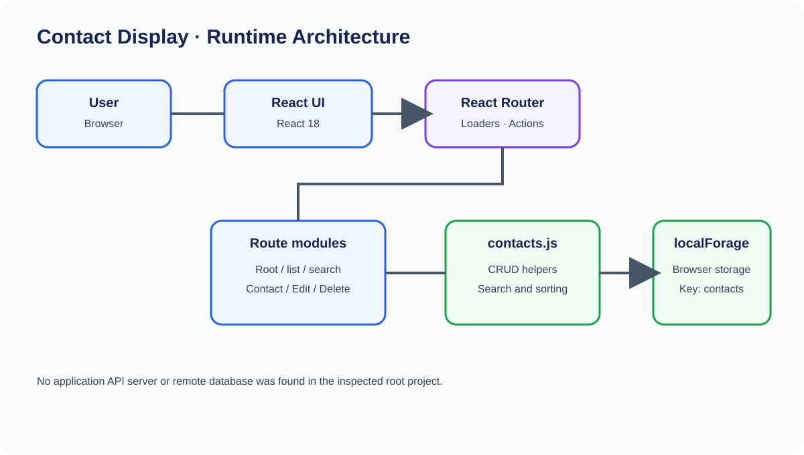
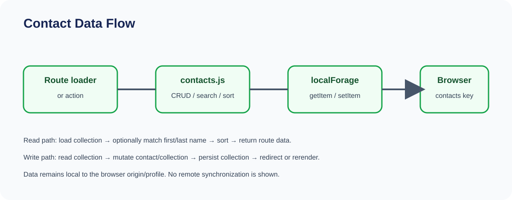
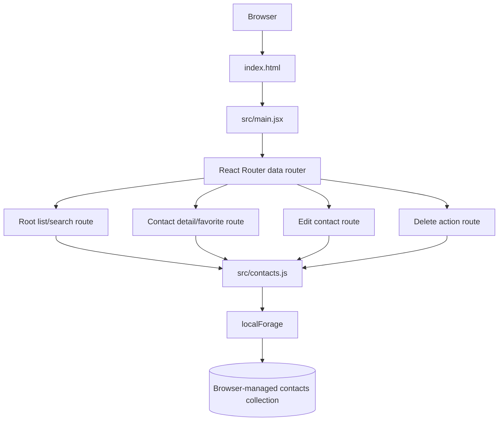

<p align="center">
  
</p>

<div align="center">

# 👤 Contact Display

**A client-side contact manager built with React 18, React Router, Vite, and localForage.**

[](https://react.dev/)
[](https://vitejs.dev/)
[](https://reactrouter.com/)
[](LICENSE)
[](https://github.com/Brajesh31/Contact-Display/commits/main)
[](https://github.com/Brajesh31/Contact-Display/issues)
[](docs/README.md)

</div>

---

## 📌 Project at a glance

| Property | Repository evidence |
|---|---|
| Application | Client-side contact organizer / React Router learning project |
| UI | React 18 |
| Routing | React Router DOM 6 data router |
| Build tool | Vite 5 |
| Persistence | localForage browser storage |
| Search | match-sorter |
| Sorting | sort-by |
| Styling | Application CSS and existing Bootstrap assets |
| Package manager | npm with committed lockfile |
| Backend | No application server found in inspected project files |
| Remote database | None established by inspected implementation |
| HTTP API | No public server API contract found |

> [!IMPORTANT]
> This project is documented as a client-side React application. The inspected implementation does not establish a MERN backend, MongoDB, Express server, remote REST API, account system, or cloud synchronization. Contact records are stored locally in the browser through localForage.

## ✨ Features

| Feature | Behavior found in source | Main implementation |
|---|---|---|
| 📇 Contact list | Loads and displays saved records. | `src/routes/root.jsx` |
| 🔎 Search | Matches first and last names from the `q` query. | Root route and `src/contacts.js` |
| ➕ Create | Creates a record and redirects to its edit route. | Root route action |
| 👤 View | Loads and displays one contact. | `src/routes/contact.jsx` |
| ⭐ Favorite | Updates favorite value via a router fetcher form. | Contact route action |
| ✏️ Edit | Submits form data and redirects to details. | `src/routes/edit.jsx` |
| 🗑️ Delete | Requests confirmation, runs local data action, redirects. | `src/routes/destroy.jsx` |
| 💾 Persistence | Stores contacts in browser through localForage. | `src/contacts.js` |
| ⚠️ Route errors | Router error element handles route exceptions. | `src/error.jsx` |

These are static source observations, not claims that all flows passed runtime tests. See [known issues](docs/known-issues.md).

## 🖼️ Architecture visuals

<p align="center"></p>
<p align="center"></p>
<p align="center"></p>

These are technical illustrations, not application screenshots. Genuine UI screenshots have not been captured and verified in this repository. See [visual assets](docs/assets/README.md).

## 🏛️ Architecture



### 🧭 Route inventory

| URL | Screen/action | Loader | Action | Result |
|---|---|---|---|---|
| `/` | List and index state | Root loader | Root action | Loads list/search; creates and redirects to edit. |
| `/contacts/:contactId` | Contact details | Contact loader | Contact action | Displays contact and toggles favorite. |
| `/contacts/:contactId/edit` | Contact editor | Edit loader | Edit action | Loads and updates fields. |
| `/contacts/:contactId/destroy` | Destructive action | None | Destroy action | Deletes and redirects to root. |

These are client-side routes, not remote server endpoints. See [page-by-page guide](docs/page-documentation.md) and [route/state model](docs/architecture/route-and-state-model.md).

## 🧰 Technology stack

| Layer | Technology | Purpose |
|---|---|---|
| UI | React 18 | Component rendering. |
| Routing | React Router DOM 6 | Browser routing, loaders, actions, navigation. |
| Build | Vite 5 | Development and production bundle. |
| Storage | localForage 1.10 | Browser-managed asynchronous persistence. |
| Search | match-sorter 6 | Contact name matching. |
| Sorting | sort-by 1 | Contact ordering. |
| Styles | CSS and existing Bootstrap assets | Application presentation. |
| Static analysis | ESLint 8 | Configured lint command. |

Exact dependency ranges and scripts remain in existing `package.json` and `package-lock.json`; they are preserved during this documentation enhancement.

## 🚀 Run locally

### Prerequisites
- Git
- Node.js compatible with existing Vite 5 toolchain
- npm

### Installation

```bash
git clone https://github.com/Brajesh31/Contact-Display.git
cd Contact-Display
npm ci
npm run dev
```

Vite prints the local development URL in the terminal.

### Existing npm commands

| Command | Purpose |
|---|---|
| `npm ci` | Install from committed npm lockfile. |
| `npm run dev` | Start Vite development server. |
| `npm run build` | Produce production bundle in `dist/`. |
| `npm run preview` | Preview production build locally. |
| `npm run lint` | Execute existing ESLint command. |

The inspected root manifest does not define `npm start`, server startup, database migrations, or a test runner.

## 💾 Data model and privacy

The data helper stores an array under localForage key `contacts`.

| Field | Observed purpose | Notes |
|---|---|---|
| `id` | Contact identity and route lookup. | Generated by current helper. |
| `createdAt` | Creation timestamp and sort value. | Numeric timestamp. |
| `first`, `last` | Contact name and search. | Form values. |
| `avatar` | Avatar image URL. | May reference external host. |
| `website` | Website display/link. | UI prefixes HTTPS. |
| `number` | Phone number. | Form uses 3-3-4 digit pattern. |
| `notes` | Free-form notes. | May contain personal data. |
| `favorite` | Favorite marker. | Updated by contact action. |

This is an observed JavaScript object shape, not a remote database schema. Records are browser-profile/origin scoped; clearing site data can remove them. No cloud backup or cross-device sync is established. See [data architecture](docs/architecture/data-architecture.md) and [privacy guidance](docs/privacy.md).

## 🧪 Quality and verification

Existing application commands:

```bash
npm run lint
npm run build
```

Documentation validation:

```bash
python scripts/validate_docs.py
python scripts/validate_links.py
python scripts/validate_svg.py
```

A documented command is not evidence of a passing run. Check its actual exit code or CI run. No application test runner is declared in the inspected manifest.

## 🔐 Security boundary

Browser storage is controlled by the user and does not provide server-side authentication or authorization. Treat contact fields as personal data. Do not add real names, phone numbers, notes, or storage exports to public screenshots/issues. See [SECURITY.md](SECURITY.md), [security guide](docs/security.md), and [threat model](docs/threat-model.md).

## 📚 Documentation index

| Topic | Documentation |
|---|---|
| 📌 Product | [Overview](docs/product-overview.md) · [Features](docs/features.md) · [Requirements](docs/functional-requirements.md) · [User journeys](docs/user-journeys.md) · [Scope](docs/scope-and-limitations.md) |
| 🏛️ Architecture | [Architecture](docs/architecture.md) · [System design](docs/system-design.md) · [Project structure](docs/project-structure.md) · [Route/state model](docs/architecture/route-and-state-model.md) · [Traceability](docs/architecture/requirements-traceability.md) |
| 🧭 Frontend | [Pages/routes](docs/page-documentation.md) · [Navigation](docs/navigation-structure.md) · [Components](docs/component-library.md) · [Design system](docs/design-system.md) · [Responsive design](docs/responsive-design.md) |
| 💾 Data | [Data flow](docs/data-flow.md) · [Data architecture](docs/architecture/data-architecture.md) · [Data dictionary](docs/architecture/data-dictionary.md) · [Persistence](docs/database.md) |
| 🛠️ Development | [Installation](docs/installation.md) · [Getting started](docs/getting-started.md) · [Developer guide](docs/developer-guide.md) · [Commands](docs/commands-reference.md) · [Troubleshooting](docs/troubleshooting.md) |
| 🧪 Quality | [Testing](docs/testing.md) · [Test strategy](docs/test-strategy.md) · [Quality gates](docs/quality-gates.md) · [Accessibility](docs/accessibility.md) · [Known issues](docs/known-issues.md) |
| 🔐 Security/privacy | [Security](docs/security.md) · [Threat model](docs/threat-model.md) · [Privacy](docs/privacy.md) · [Risk register](docs/risk-register.md) |
| 🚀 Operations | [Deployment](docs/deployment.md) · [CI/CD](docs/ci-cd.md) · [Monitoring](docs/monitoring.md) · [Maintenance](docs/maintenance.md) |
| 🧩 Reuse | [Templates](docs/templates/README.md) · [Visual assets](docs/assets/README.md) · [Architecture catalog](docs/architecture/README.md) |

Start at [the documentation hub](docs/README.md).

## 🛣️ Roadmap and contribution

See [ROADMAP.md](ROADMAP.md) for proposed work and [CONTRIBUTING.md](CONTRIBUTING.md) for contribution guidance. Planned work is not represented as implemented.

## 🔒 Repository enhancement boundary

Documentation enhancement preserves application source, styles, static application assets, HTML entry point, dependency manifests, lockfiles, and build configuration. See [project structure and ownership](docs/project-structure.md).

## 📄 License

Distributed under the MIT License. See [LICENSE](LICENSE).

Last updated: 2026-11-18 02:57 UTC
