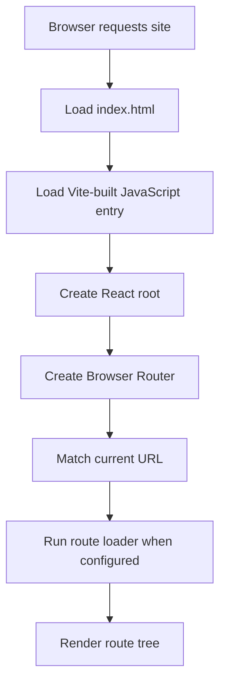

# 🔄 Application Lifecycle

## 🚀 Startup lifecycle

## 🔁 Interaction lifecycle

| User action | Router behavior | Data helper | Result |
|---|---|---|---|
| Search | Root loader re-runs with `q`. | `getContacts(query)`. | Filtered contact list. |
| Create | Root action handles form submission. | `createContact()`. | Redirect to edit screen. |
| Open contact | Contact loader runs with route ID. | `getContact(id)`. | Detail screen or 404 response. |
| Favorite | Contact action receives form data. | `updateContact(id, updates)`. | Updated favorite state. |
| Save edit | Edit action receives form data. | `updateContact(id, updates)`. | Redirect to details. |
| Delete | Destroy action runs. | `deleteContact(id)`. | Redirect to root. |

## 💾 Persistence lifecycle

Contact data is stored in localForage under the `contacts` key. This is local browser persistence, not a server database or synchronization protocol.

## ⚠️ Lifecycle verification status

This sequence is mapped from source. No end-to-end runtime execution is claimed in this document.
