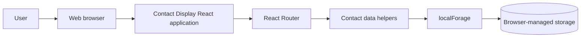

# 🏛️ Architecture

## 📌 Architecture summary

Contact Display is a single-page React application served and bundled by Vite. React Router DOM provides browser navigation and data-router loaders/actions. Route modules call a shared contact data module, which reads and writes the `contacts` collection through localForage.

No application server or remote database is present in the inspected root source.

## 🧱 System context

## 🧩 Runtime components

| Component | Responsibility | Source |
|---|---|---|
| Vite | Development server and production bundling. | `vite.config.js`, `package.json` |
| React root | Mounts the application. | `src/main.jsx` |
| Router | Maps URLs to route elements, loaders, and actions. | `src/main.jsx` |
| Root route | Loads list, search query, and create action. | `src/routes/root.jsx` |
| Contact route | Reads details and handles favorite update. | `src/routes/contact.jsx` |
| Edit route | Loads and updates record fields. | `src/routes/edit.jsx` |
| Destroy action | Deletes selected record. | `src/routes/destroy.jsx` |
| Data module | Contact CRUD and search/sort behavior. | `src/contacts.js` |
| Persistence | Browser storage abstraction. | localForage dependency |

## 🔐 Trust boundaries

- The browser and its storage are controlled by the end user.
- Contact fields are user-provided input and must be treated as untrusted.
- No server-side trust boundary, identity provider, or authorization service is shown.
- External avatar URLs and website links may cause the browser to request third-party resources.

## 📐 Architecture decisions

See [system design](system-design.md), [data architecture](architecture/data-architecture.md), and [decision log](decision-log.md).

## ⚠️ Accuracy notes

The existing README previously described a MERN stack, MongoDB, REST API, Tailwind, and separate client/server directories. Those elements were not found in the inspected root application and are intentionally not described as current architecture.
