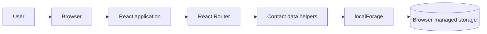
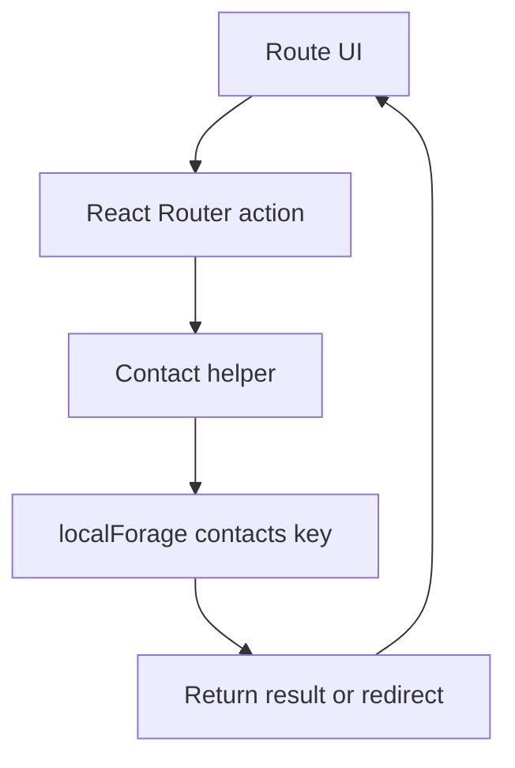

# 🏛️ Architecture and Diagram Catalog

## 📌 Architecture overview

Contact Display is a browser-side React application. Route modules call contact helpers, which use localForage for browser-managed persistence. No remote backend or server database is established by inspected application code.

## 🖼️ Existing SVG diagrams

| Diagram | Asset | Explanation |
|---|---|---|
| System architecture | [SVG](../assets/architecture/contact-display-architecture.svg) | Browser, React Router, contact helpers, and localForage boundary. |
| Contact data flow | [SVG](../assets/architecture/contact-data-flow.svg) | Data read/write interaction. |
| Contact sequence | [SVG](../assets/architecture/contact-sequence.svg) | Route action and persistence sequence. |
| Project branding | [Banner](../assets/branding/contact-display-banner.svg) | Project identity. |

## 🧭 Editable Mermaid sources

### System context

### Contact write flow

See [route and state model](route-and-state-model.md) for route hierarchy, loader flow, state inventory, and sequence diagram.

## 🔗 Supporting architecture documents

| Document | Scope |
|---|---|
| [Data architecture](data-architecture.md) | Browser storage and contact record flow. |
| [Data dictionary](data-dictionary.md) | Observed contact properties. |
| [API boundary](api-boundary.md) | Why router actions are not public REST APIs. |
| [Component hierarchy](component-hierarchy.md) | Route/layout component relationships. |
| [Deployment view](deployment-view.md) | Static client deployment model and caveats. |
| [Security view](security-view.md) | Trust boundaries and browser storage. |
| [Module dependencies](module-dependency.md) | Source module relationships. |
| [Runtime sequence](runtime-sequence.md) | Navigation and data access. |
| [Sequence flows](sequence-flows.md) | Interaction sequences. |
| [Route/state model](route-and-state-model.md) | Route transitions and UI states. |
| [Requirements traceability](requirements-traceability.md) | Feature/source/test evidence mapping. |

## ✅ Diagram quality rules

- Diagrams must match checked-in source and actual behavior.
- Distinguish browser routes/actions from network endpoints.
- Do not invent a backend, database server, authentication, or cloud sync.
- Keep editable Mermaid source alongside SVG/PNG exports where useful.
- Recheck diagrams when route registration or data flow changes.
