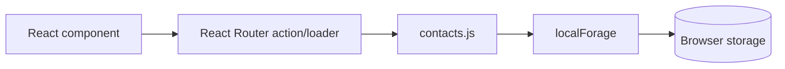

# 🔌 API Boundary

The inspected app uses React Router's client-side loaders and actions. These are not a public HTTP API.

No server route, controller, REST endpoint, API authentication middleware, or remote API service was identified in the root application files.
