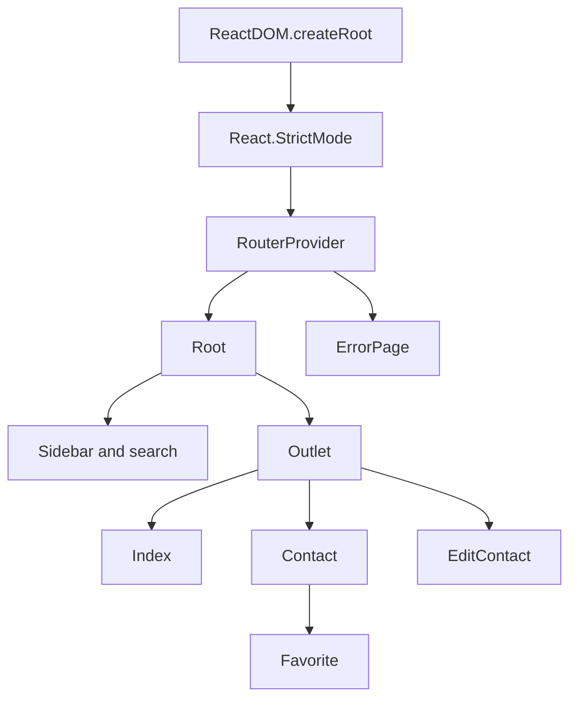

# 🌳 Component Hierarchy

| Component | Responsibility |
|---|---|
| Root | Shared app shell and contact navigation. |
| Index | Initial route content. |
| Contact | Contact detail and actions. |
| Favorite | Favorite state submission UI. |
| EditContact | Contact edit fields and save/cancel. |
| ErrorPage | Router error presentation. |

See [component architecture](../component-architecture.md) for the detailed inventory.
