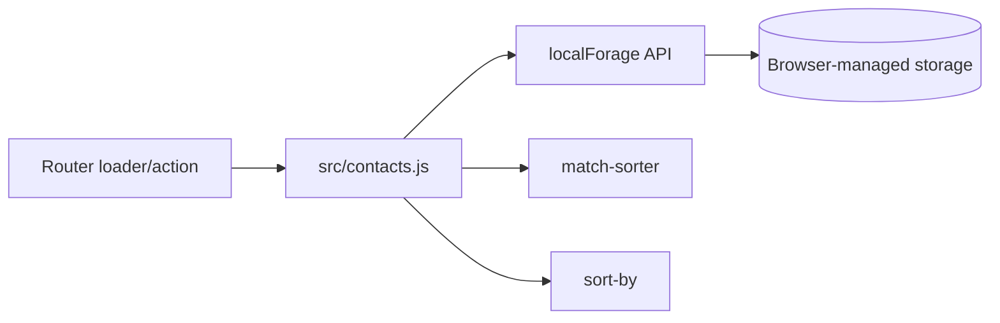

# 💾 Data Architecture

## 🧭 Overview

The current data layer is a browser-side module. Route modules call `src/contacts.js`; the helper reads and writes the `contacts` key through localForage.

## 📋 Observed data object

| Property | Type observed / implied | Usage |
|---|---|---|
| `id` | String | Contact identifier. |
| `createdAt` | Number | Creation timestamp. |
| `first` | String / absent | First name. |
| `last` | String / absent | Last name. |
| `avatar` | String / absent | Avatar URL. |
| `website` | String / absent | Website display/link. |
| `number` | String / absent | Phone number display. |
| `notes` | String / absent | Free-form notes. |
| `favorite` | Boolean-like value | Favorite indicator. |

This table documents fields shown or written by the inspected code; it is not a server schema.

## 🔐 Data ownership and boundaries

- Data is scoped to browser storage, not a remote user account.
- The project does not implement a database migration service.
- No server-side access control was found.
- Browser storage can be cleared or modified by the user.

## ⚠️ Data integrity review

The helper functions assume certain collection and index conditions. See [known issues](../known-issues.md) for the delete/update edge cases. No schema or runtime behavior has been modified.
