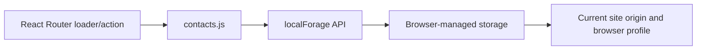

# 💾 Data Architecture and Persistence Boundary

## 📌 Overview

The application uses localForage as an asynchronous browser-storage abstraction. The primary helper is `src/contacts.js`; it reads/writes the contact collection at key `contacts`.

## 🏛️ Data architecture

## 🧾 Observed record fields

| Field | Purpose | Type observed/expected | Notes |
|---|---|---|---|
| `id` | Record identity and route lookup. | String | Random base-36 substring. |
| `createdAt` | Creation timestamp/sort key. | Number | Uses `Date.now()`. |
| `first` | First name. | String/empty | Search and display. |
| `last` | Last name. | String/empty | Search and sorting. |
| `avatar` | Avatar URL. | String/empty | Image source. |
| `website` | Website text. | String/empty | UI prefixes `https://`. |
| `number` | Telephone number. | String/empty | Edit field has a format pattern. |
| `notes` | Free-form notes. | String/empty | Treat as personal data. |
| `favorite` | Favorite marker. | Boolean-like | Action converts submitted value to boolean. |

This is an observed JavaScript object shape, not a formal database schema or server contract.

## 🔄 Read flow

1. A route loader calls `getContacts` or `getContact`.
2. The helper reads `contacts` from localForage.
3. Listing applies optional name matching and sorting.
4. The loader returns data to React Router for rendering.

## ✍️ Write flow

1. A route action receives submitted form data.
2. It calls `createContact`, `updateContact`, or `deleteContact`.
3. The helper updates the collection.
4. The helper writes the collection through localForage.
5. The action returns data or a redirect.

## 🔐 Boundaries and limitations

| Concern | Current evidence |
|---|---|
| Persistence | Browser-managed storage through localForage. |
| Remote database | Not found in inspected implementation. |
| Cloud synchronization | Not found. |
| Backup/export | No application backup/export flow established. |
| Authentication | No server-side identity system established. |
| Authorization | No server-side access-control layer established. |
| Multi-device sharing | Not established. |
| Data deletion | Per-contact delete action is present. |

## ⚠️ Data integrity risks

Static review notes include assumptions around missing collections and deleting unknown IDs. See [known issues](../known-issues.md). These findings were not repaired or runtime-reproduced in this documentation task.

## 🔗 Related documents

- [Data dictionary](data-dictionary.md)
- [Persistence overview](../database.md)
- [Privacy guidance](../privacy.md)
- [Data flow](../data-flow.md)
