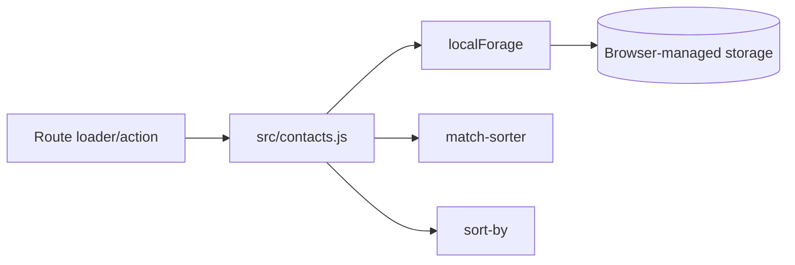

# 💾 Data Architecture

The data layer is browser-side. Route modules call `src/contacts.js`; the helper reads and writes the `contacts` key through localForage.

## 📋 Observed contact fields

| Property | Observed type / shape | Usage |
|---|---|---|
| `id` | String | Contact identifier. |
| `createdAt` | Number | Creation timestamp. |
| `first`, `last` | Optional strings | Display and search. |
| `avatar` | Optional string | Avatar URL. |
| `website` | Optional string | Website display/link. |
| `number` | Optional string | Phone number. |
| `notes` | Optional string | Free-form notes. |
| `favorite` | Boolean-like value | Favorite indicator. |

This is not a formal server schema. Data is scoped to browser storage, not a remote account. No migration or server-side access-control service is present in the inspected root project. Browser storage can be cleared or modified by the user.

See [known issues](../known-issues.md) for collection and index assumptions in the current helpers.
