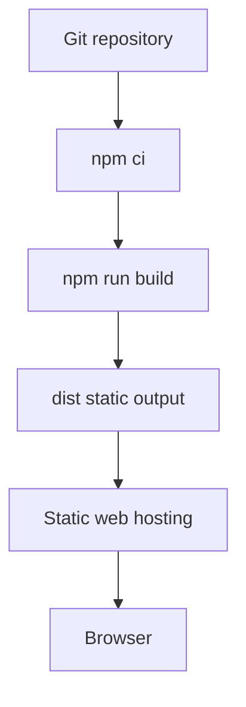

# 🚀 Deployment View

## Current build path

## 🧱 Deployment units

| Unit | Current evidence |
|---|---|
| Static client bundle | Vite build script. |
| Server API | Not found in inspected root project. |
| Database server | Not found in inspected root project. |
| CDN / hosting | Provider not established. |
| Secrets service | Not established. |

A static host must serve the app entry for supported client-side routes. Browser persistence is origin-scoped; changing domain or protocol can make prior browser-local data unavailable. No provider-specific deployment is claimed.
