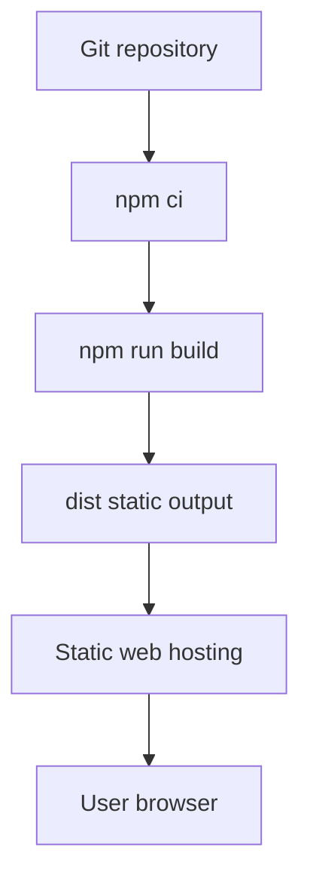

# 🚀 Deployment View

## Current build path

| Deployment unit | Current evidence |
|---|---|
| Static client bundle | Vite build script. |
| Server API | Not found in inspected root project. |
| Database server | Not found in inspected root project. |
| Hosting provider / CDN | Not established. |
| Secrets service | Not established. |

Static hosting must serve the app entry for supported client routes. Browser persistence is origin-scoped. No live hosting provider is claimed.
