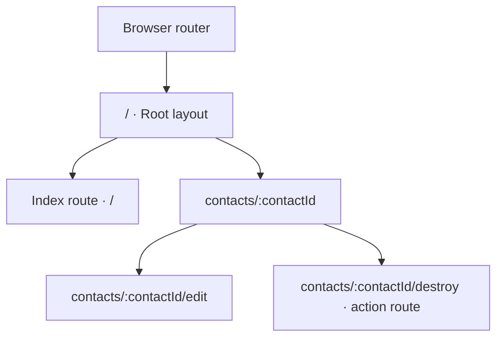
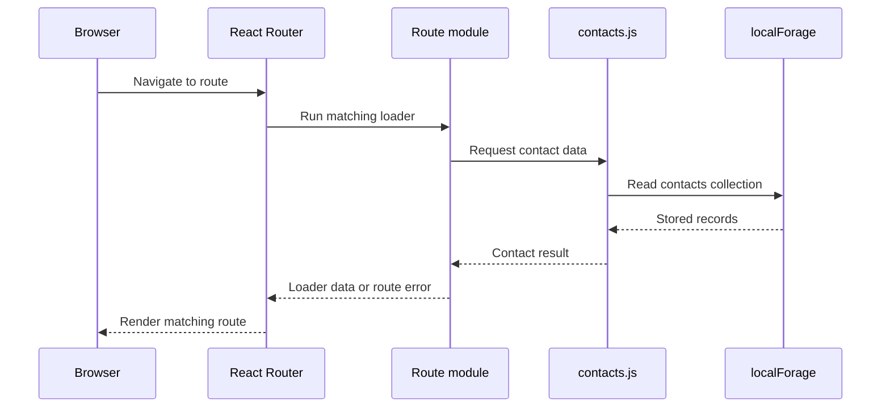

# 🧭 Route and UI State Model

## 📌 Purpose

Describe the client-side route graph and interaction states configured in `src/main.jsx` and the route modules.

## 🗺️ Route hierarchy

## 🔁 Loader sequence

## 📊 State catalog

| State | Trigger | Expected UI | Source |
|---|---|---|---|
| Populated list | Collection contains records. | Sidebar lists records. | `root.jsx` |
| Empty list | No saved records. | “No contacts” message. | `root.jsx` |
| Search pending | Router navigates with `q`. | Loading class/spinner state. | `root.jsx` |
| Contact selected | Contact URL resolves. | Details panel. | `contact.jsx` |
| Contact missing | Loader cannot find ID. | 404 route error. | `contact.jsx` |
| Edit form | Edit URL resolves. | Fields populated from record. | `edit.jsx` |
| Favorite pending | Fetcher submitted form data. | Button reflects pending value. | `contact.jsx` |
| Delete confirmation | User submits delete form. | Browser confirmation dialog. | `contact.jsx` |
| Delete complete | Destroy action redirects. | Return to root. | `destroy.jsx` |

## 🔒 State ownership

- React Router manages navigation and loader/action state.
- React renders components.
- localForage stores records under the `contacts` key.
- No server session, remote synchronization, or centralized state service is established by inspected implementation.

## ⚠️ Source finding

Root route seed-card initialization calls and identifiers are inconsistent in currently inspected source. See [known issues](../known-issues.md). This document does not modify or claim to repair that behavior.
