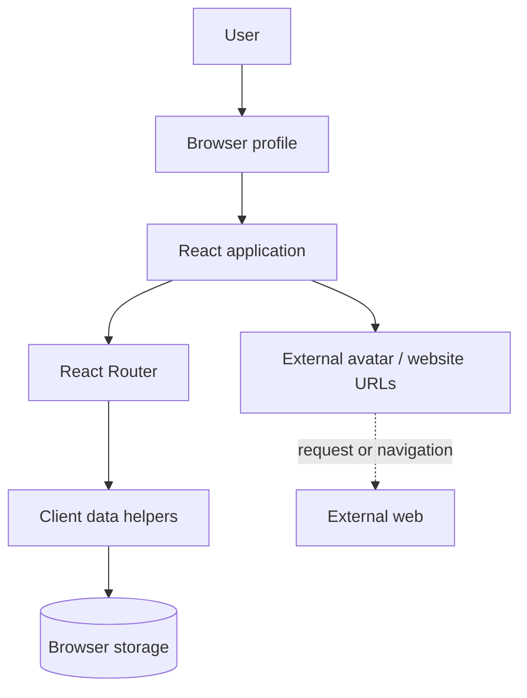

# 🛡️ Security Architecture View

| Boundary | Security meaning |
|---|---|
| Browser profile | Device/profile controls govern access to stored contacts. |
| Application UI | Client code can be inspected or modified by the user. |
| Browser storage | Not a server-side security boundary. |
| External URLs | User-provided values may point outside the application. |

No backend authentication, authorization, or server firewall layer was found in the inspected root source. See [threat model](../threat-model.md).
