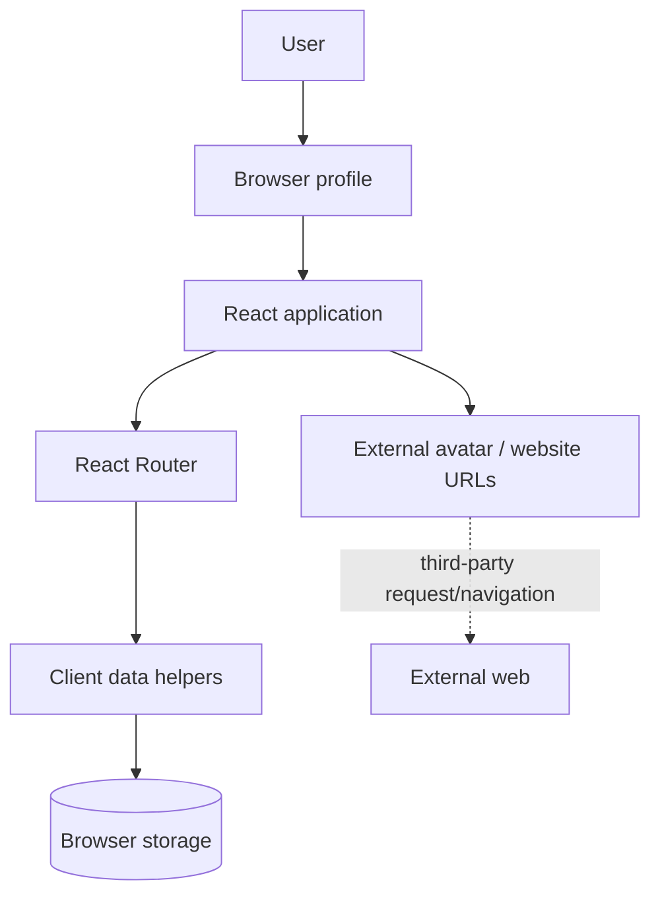

# 🛡️ Security Architecture View

## 🔐 Boundaries and controls

| Boundary | Security meaning |
|---|---|
| Browser profile | User/device access controls govern stored contact visibility. |
| Application UI | Client code can be inspected or modified by the user. |
| Browser storage | Not a server-side security boundary. |
| External URLs | Values are user-provided and can point outside the application. |

There is no verified backend authentication, authorization, or server firewall layer in the inspected source. See [threat model](../threat-model.md).
