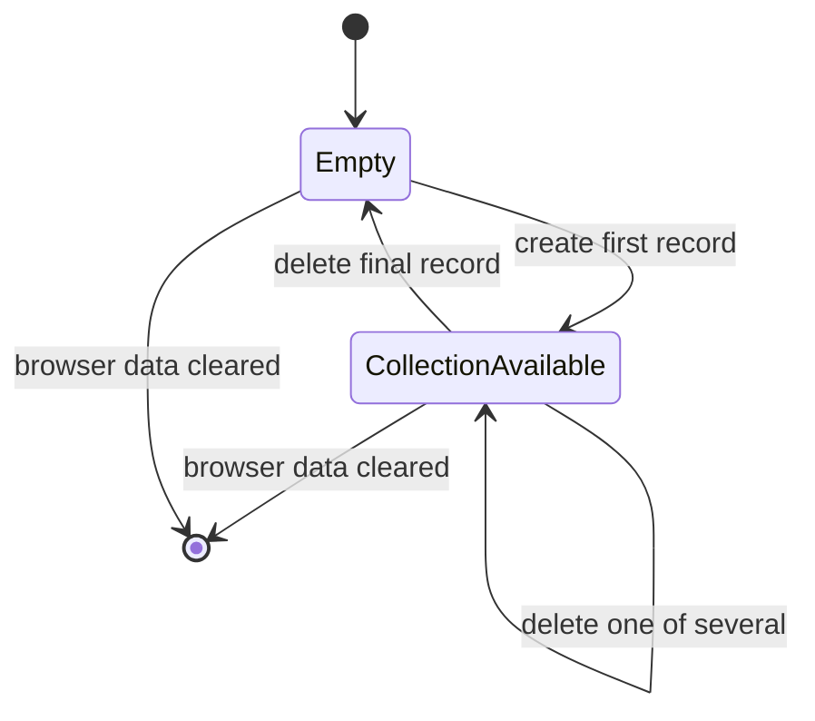

# 💾 Storage State Model

The state model is conceptual and reflects the collection lifecycle. It is not a transactional database state machine. Current helper edge-case assumptions are listed in [known issues](../known-issues.md).
