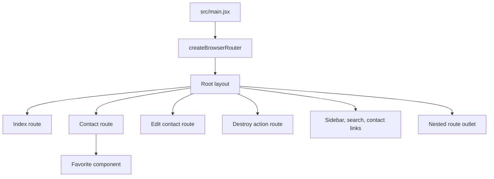

# 🧩 Component Architecture

## 🏛️ Route/component structure

## 📚 Responsibilities

| Component/module | Responsibility |
|---|---|
| `Root` | Shared sidebar and nested content layout. |
| `Index` | Root selection/welcome state. |
| `Contact` | Contact details and action controls. |
| `Favorite` | Fetcher-driven favorite toggle control. |
| `EditContact` | Contact edit form. |
| `ErrorPage` | Router error display. |
| `destroyAction` | Delete mutation route action. |

## 🔒 Component boundaries

The router uses route modules as UI/data boundaries. Contact persistence logic lives in `src/contacts.js` rather than being implemented independently in each route. This page documents the current arrangement; it does not propose a component refactor.
