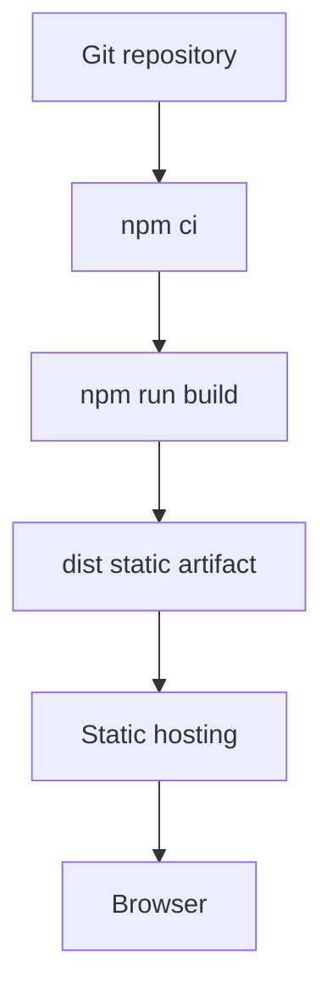

# 🚀 Deployment

The configured build command is `npm run build`, using Vite. The default output is `dist/`.

## Hosting considerations
- Configure the host to serve the app entry for supported client-side routes.
- Verify browser refresh on nested contact routes.
- Use HTTPS.
- Keep a stable origin because browser storage is origin-scoped.
- Do not assume a backend/database is part of the current app.

No live provider, production URL, or deployed build verification was established during inspection.
