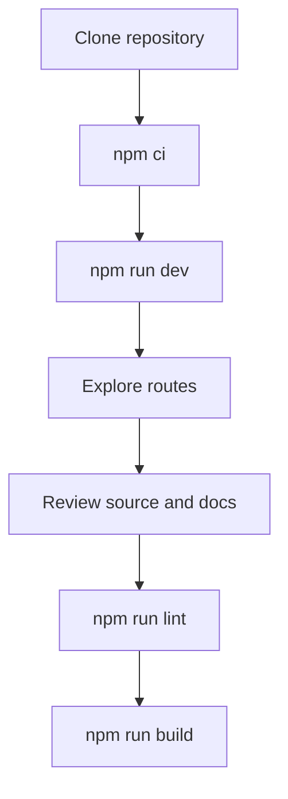

# 💻 Local Development

Use [commands reference](commands-reference.md) for the package scripts. Keep development-only data private and do not commit local browser exports or credentials.

Documentation maintenance must not change application modules, package files, lockfiles, or build configuration.
