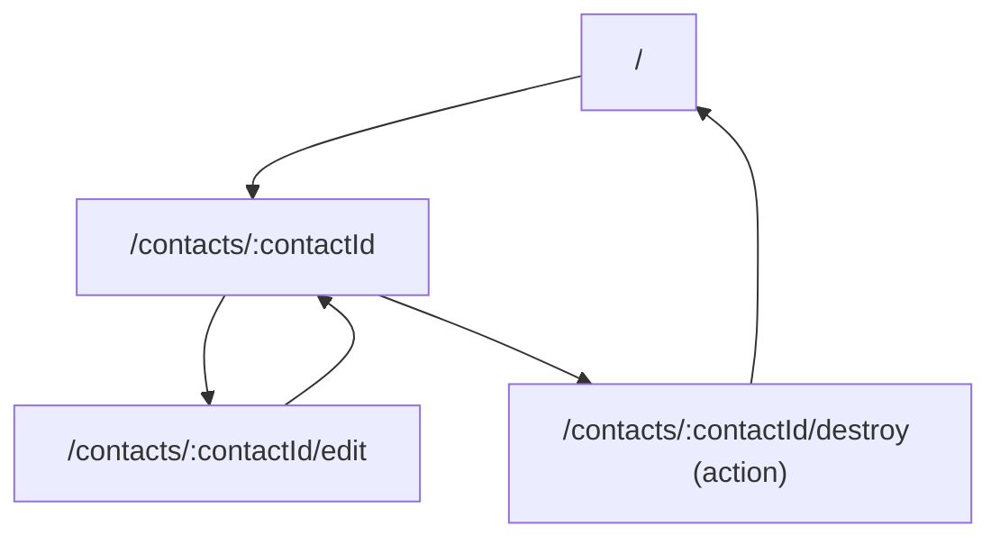

# 🧭 Navigation Structure

The sidebar title returns to root, contact links open detail routes, Edit opens the edit route, Save redirects to detail, Delete redirects to root, and Cancel uses browser history.
