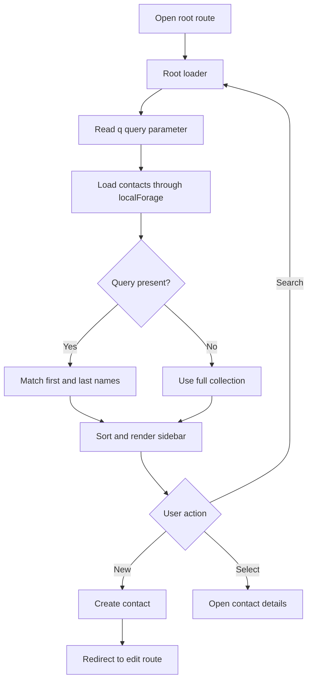
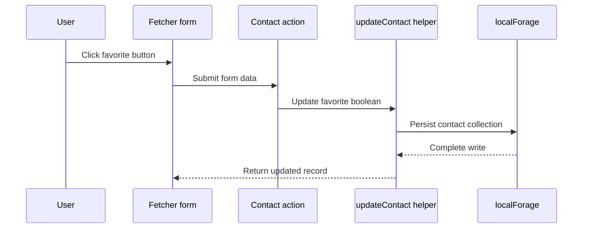
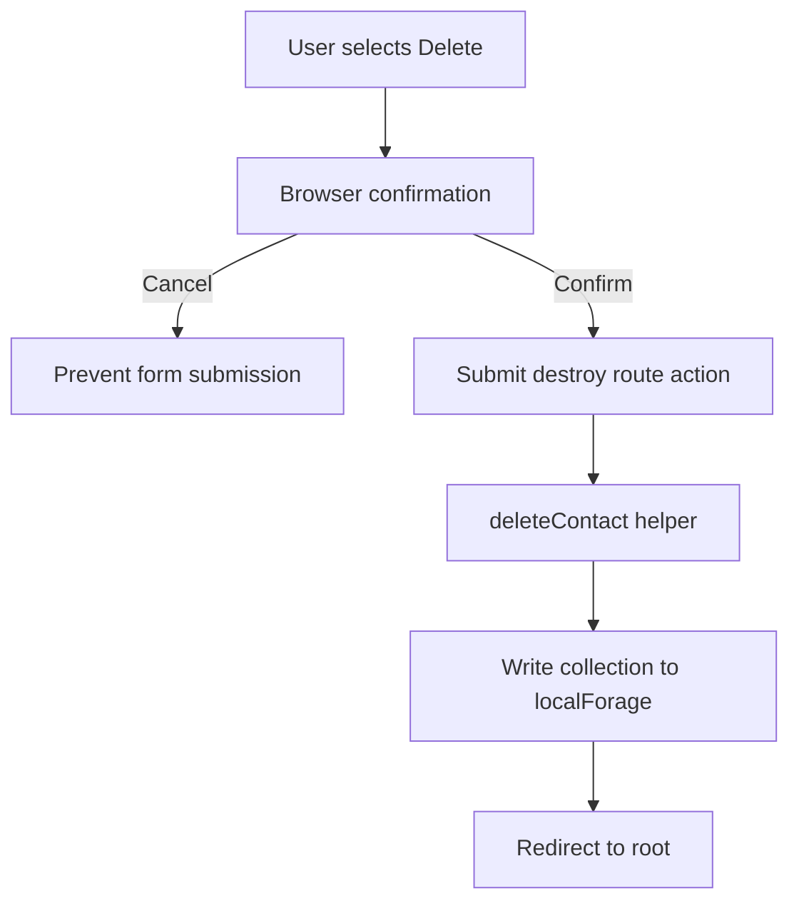

# 🖥️ Page, Route, and Interaction Documentation

This guide is based on static inspection of the React Router configuration and route components, not a live browser QA run.

## 🗺️ Route inventory

| Route | Screen | Source | Data loading | User actions |
|---|---|---|---|---|
| `/` | Contact list and index state | `root.jsx`, `index.jsx` | Root loader reads `q` and contact collection. | Search, create, select contact. |
| `/contacts/:contactId` | Contact details | `contact.jsx` | Contact loader reads record and throws 404 if absent. | Favorite, edit, delete. |
| `/contacts/:contactId/edit` | Contact editor | `edit.jsx` | Edit loader reads selected record. | Edit fields, save, cancel. |
| `/contacts/:contactId/destroy` | Destructive action route | `destroy.jsx` | No loader registered. | Delete action then redirect to `/`. |

## 1. 📇 Root layout and contact list

**Implementation:** `src/routes/root.jsx`

| Element | Observed behavior | Notes |
|---|---|---|
| Sidebar title | Link to `/`. | Visible text is “React Router Contacts”. |
| Search | Form submits `q` as the user types. | Helper matches first and last names. |
| New contact | Posts to root action. | Creates record and redirects to edit route. |
| Contact navigation | Lists contact links. | Displays name or “No Name”; adds star for favorites. |
| Detail outlet | Renders the nested route. | Loading class follows router navigation state. |
| Empty collection | Displays “No contacts”. | Distinct from the index welcome state. |

### 🔄 Root workflow

## 2. 👤 Contact details

**Implementation:** `src/routes/contact.jsx`

| Element | Behavior |
|---|---|
| Avatar | Renders the saved avatar URL when available. |
| Name | Displays first/last name or “No Name”. |
| Favorite | Fetcher form submits the inverse favorite value. |
| Website | Constructs a link by prefixing `https://` to stored website text. |
| Phone | Displays saved number when present. |
| Notes | Displays free-form notes when present. |
| Edit | Navigates to relative `edit` route. |
| Delete | Submits to relative `destroy` route after browser confirmation. |

### ⭐ Favorite sequence

## 3. ✏️ Edit contact

**Implementation:** `src/routes/edit.jsx`

| Field | Form name | Input | Notes |
|---|---|---|---|
| First name | `first` | Text | Optional in current markup. |
| Last name | `last` | Text | Optional in current markup. |
| Phone | `number` | Telephone | Pattern: 3 digits, hyphen, 3 digits, hyphen, 4 digits. |
| Website | `website` | Text | Stored as text. |
| Avatar URL | `avatar` | Text | Fallback URL generated when empty. |
| Notes | `notes` | Textarea | Free-form text. |

Save submits to edit action and redirects to detail. Cancel uses browser history navigation.

## 4. 🗑️ Delete workflow

**Implementation:** `src/routes/contact.jsx`, `src/routes/destroy.jsx`

The destroy route is a browser-side router action, not an HTTP DELETE endpoint.

## 5. ⚠️ Error and fallback states

| Scenario | Source behavior | Evidence level |
|---|---|---|
| Unknown contact ID | Contact loader throws 404 response. | Static source review. |
| Unexpected route error | Configured error element renders `src/error.jsx`. | Static source review. |
| Delete cancelled | Form submission prevented by confirmation handler. | Static source review. |
| Empty collection | Root route renders “No contacts”. | Static source review. |
| Missing avatar | Image receives null source. | Static source review; browser appearance not captured. |

## 6. 📱 Responsive behavior

The checked-in styles determine breakpoints and layout. Do not claim responsive testing based on source inspection alone.

| Viewport | Verification needed | Current evidence |
|---|---|---|
| Desktop | Sidebar, detail panel, navigation, forms. | Not runtime-verified. |
| Tablet | Layout transition, overflow, touch targets. | Not runtime-verified. |
| Mobile | Navigation, form usability, wrapping, scrolling. | Not runtime-verified. |
| Zoom/text scaling | Reflow and clipping. | Not runtime-verified. |

## 7. 📸 Screenshot evidence

No genuine application screenshots are claimed here. Capture screenshots from the running app with synthetic test records and store them under `docs/assets/screenshots/`. Never expose real names, phone numbers, notes, or private browser storage.

## 🔎 Related guides

- [Features](features.md)
- [Navigation](navigation-structure.md)
- [Component inventory](component-library.md)
- [Known issues](known-issues.md)
- [Accessibility](accessibility.md)
