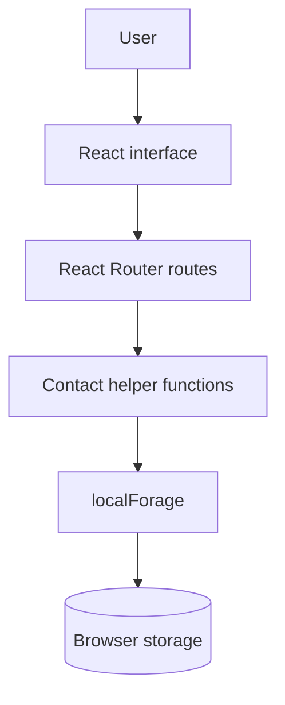

# 🧩 Solution Overview

The application uses a browser-rendered React interface and React Router data routes. A shared data module encapsulates contact operations and localForage storage.

## Solution characteristics
- Client-side application.
- Browser-local persistence.
- Route loader/action pattern.
- No verified backend API or database service.
- Vite-based local development and static production build.
