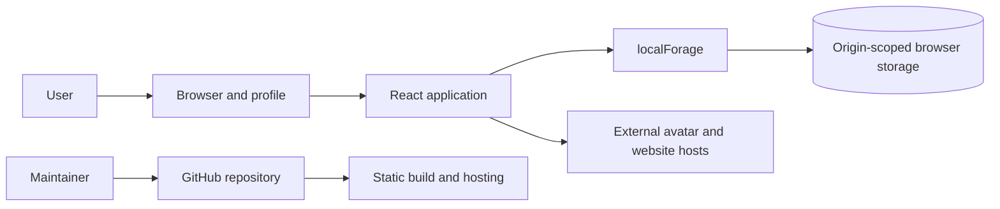

# 🛡️ Threat Model

## 🎯 Scope and assumptions

This lightweight threat model covers the inspected client-side Contact Display application and repository support. It does not model a backend because no application server or remote database was established in the inspected implementation.

## 🧭 System boundary

## 🗃️ Assets

| Asset | Security objective | Impact if compromised |
|---|---|---|
| Contact names and phone numbers | Confidentiality and integrity. | Privacy exposure or altered records. |
| Contact notes | Confidentiality and integrity. | Exposure of sensitive free text. |
| Browser storage | Integrity and availability. | Data loss, tampering, or local access. |
| Avatar and website URLs | Safe outbound navigation/resource loading. | Tracking or navigation to untrusted locations. |
| Source and workflows | Integrity of published application. | Malicious code or compromised release. |

## 👥 Actors

| Actor | Capability | Trust level |
|---|---|---|
| Legitimate user | Adds, reads, edits, and deletes local records. | User-controlled input. |
| Shared-profile user | May access data in the same unlocked browser profile. | Not trusted for contact confidentiality. |
| External resource host | Receives requests when an external URL is loaded/followed. | Third party. |
| Dependency publisher/attacker | May affect the application if a dependency is compromised. | External supply chain. |
| Repository contributor | Proposes code/docs/workflow changes. | Governed by GitHub permissions and review. |

## ⚠️ Threat register

| ID | Scenario | Impact | Mitigation / evidence |
|---|---|---|---|
| T-01 | Shared device exposes contacts. | Privacy loss. | Use a protected browser profile; avoid sensitive content. |
| T-02 | Origin storage is cleared or corrupted. | Data loss. | Explain local-only persistence; maintain an independent backup where needed. |
| T-03 | Untrusted URL is entered. | External request or unsafe navigation. | Treat URL fields as untrusted and review protocol handling. |
| T-04 | Dependency is compromised. | Client code compromise. | Review advisories and lockfile changes using a separate authorized dependency process. |
| T-05 | Support screenshot is not redacted. | Personal-data disclosure. | Use synthetic contacts and sanitize attachments. |
| T-06 | Workflow token has excessive permissions. | Unauthorized repository modifications. | Minimize workflow permissions and review triggers/actions. |

## 🔐 Trust boundaries

1. **Browser profile:** local storage is user-controlled and is not a server authorization boundary.
2. **External origin:** avatar and website resources may contact third-party hosts.
3. **GitHub repository:** source, documentation, and automation integrity depends on repository access controls.
4. **Hosting provider:** static deployment configuration is outside the browser application data model.

## 🧪 Review checklist

- [ ] Test URL handling for unsafe schemes and malformed values.
- [ ] Check external links and new-tab behavior.
- [ ] Confirm private contact data is absent from repository history/examples.
- [ ] Review dependency/security alerts.
- [ ] Review workflow permissions and untrusted pull-request behavior.
- [ ] Document storage limitations and data-loss scenarios.
- [ ] Assign owner and due date to unresolved high-risk findings.

## 📊 Residual risk

This is a documentation-level baseline. No penetration test, formal risk acceptance, external audit, or security certification is claimed.
