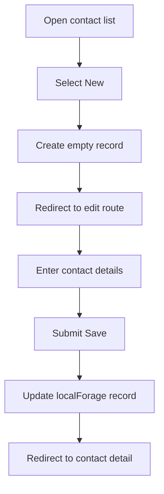
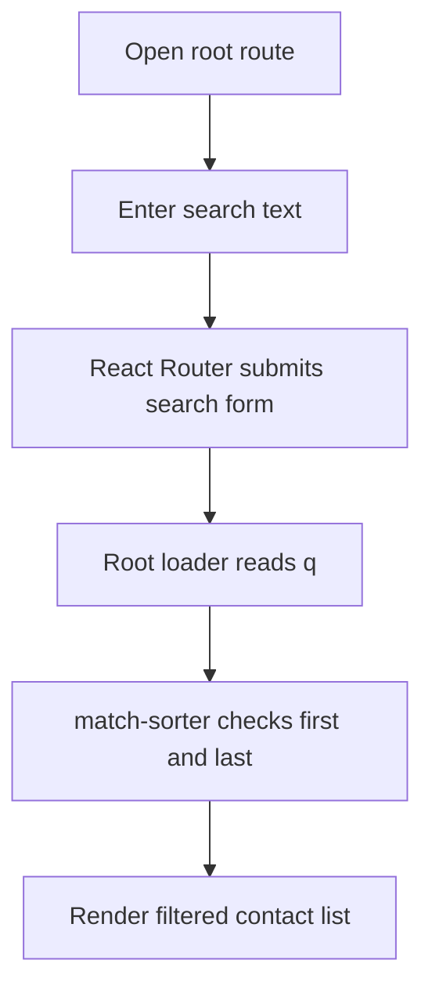
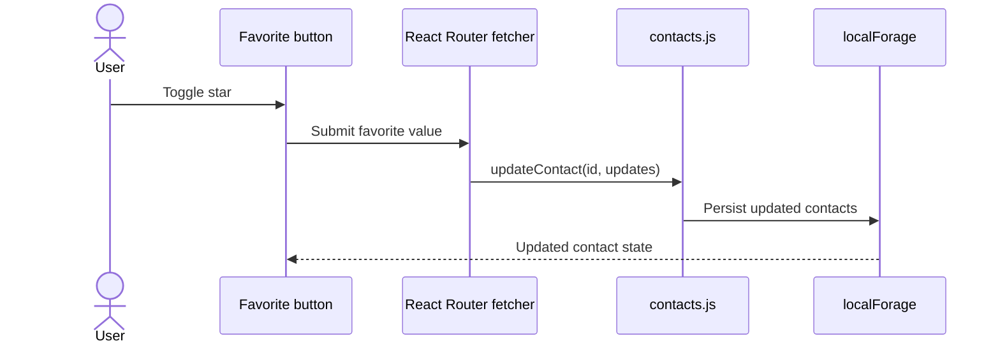
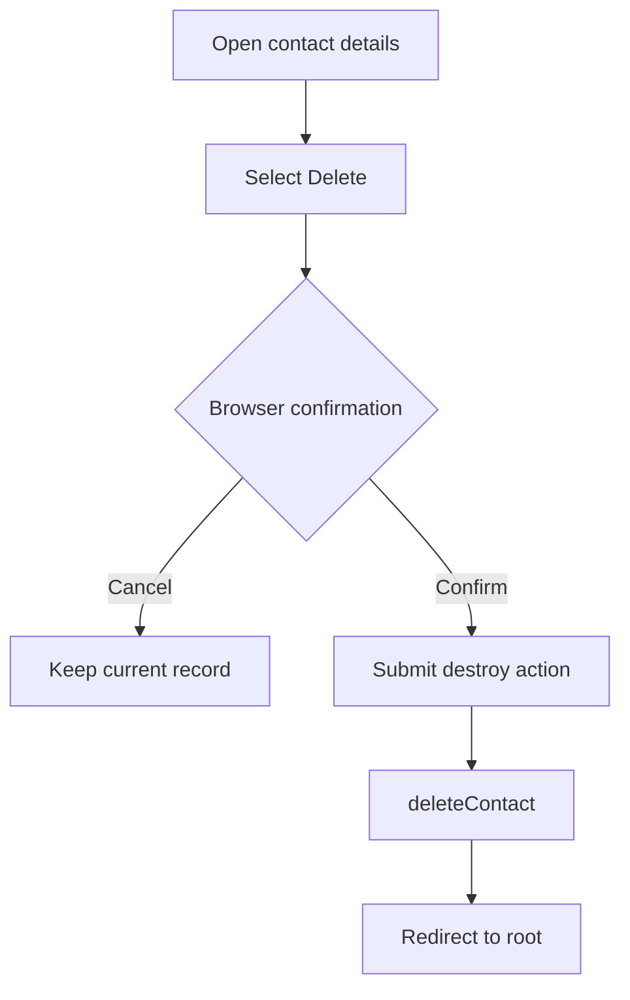

# 🧭 User Journeys

## 1. ➕ Create and save a contact

## 2. 🔎 Find a contact

## 3. ⭐ Mark a contact as favorite

## 4. 🗑️ Delete a contact

## 🧪 Journey review

The diagrams represent the intended route/action sequence visible in the source. Run each journey in a browser before treating it as a verified end-to-end test. Known source inconsistencies are listed in [known issues](known-issues.md).
